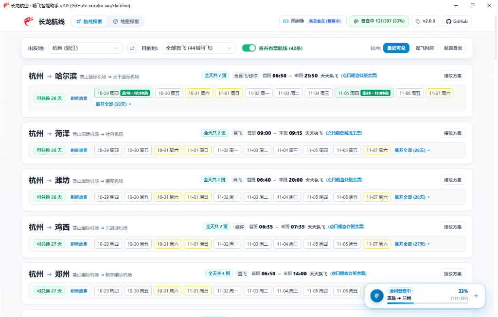
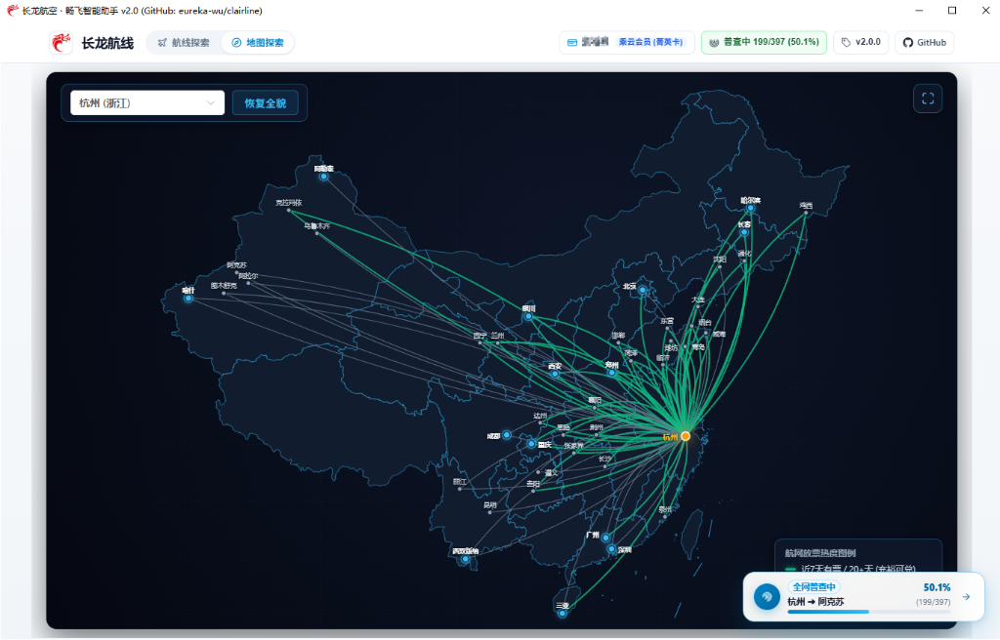

# 长龙航网助手 · macOS 版

> 把长龙航空「畅飞卡 / 积分兑换」的放票日历和余票，做成一个本地网页大盘。
> 浏览器打开就能用，数据全部留在你自己的 Mac 上，不上传任何云端。

这是 [eureka-wu/clairline](https://github.com/eureka-wu/clairline) 的 **macOS 移植分支**。
原版只支持 Windows（改注册表设代理 + `certutil` 装根证书 + WebView2 桌面壳），
本分支去掉了这些系统级依赖，改成**在本机起一个网页服务，用浏览器访问**。





---

## 它能干什么

| 功能 | 说明 |
|---|---|
| **航网大盘** | 490 条直飞航线拓扑，一张卡片一条线，显示班次、首末班时刻、可兑换天数 |
| **放票日历** | 按日期显示能不能兑，点日期胶囊就地弹出各班次余票（张数 / 机型 / 经停） |
| **地图探索** | 全屏 SVG 航网图，绿线为近期可兑，可缩放漫游 |
| **本地缓存** | 查过的结果写进 SQLite，再点同一个日期 0 毫秒出结果，不再打接口 |
| **重点监控** | 把常飞航线钉住，手动触发巡检（默认不自动跑） |
| **会员信息** | 自动读取你的会员等级与畅飞卡，显示在右上角 |

---

## 快速开始

### 第 0 步：装依赖

```bash
# 前端构建需要（只在第一次构建时用）
brew install node

# 刷新登录态需要（只在登录失效时用）
brew install mitmproxy
```

> Python 不用装，用 macOS 自带的 `python3` 即可（3.9+，项目零第三方依赖）。

### 第 1 步：拉代码

```bash
git clone https://github.com/beelzebubxbh/clairline.git
cd clairline
```

### 第 2 步：同步一次登录态

```bash
./refresh-token.sh
```

首次运行它会提示你把 mitmproxy 的根证书装进系统信任区（**只做一次**）。
复制它打印的那行 `sudo security add-trusted-cert ...` 到终端执行，输入开机密码，
然后再跑一次 `./refresh-token.sh`。

看到下面这段就说明开始抓了：

```
👉 现在请在 微信 → 长龙航空小程序 → 「我的」页面
   随便点一次畅飞卡 / 积分兑换查询
```

**去微信里操作**（小程序必须重新打开，旧的连接不走代理）。
几秒后它会自动捕获、落盘、关闭代理：

```
[✓] 登录态已保存到 /Users/你/.clairline/credentials.json
[✓] 会员档案: 你的名字 / 乘云会员 L1
```

### 第 3 步：启动

```bash
./run.sh
```

浏览器打开 <http://127.0.0.1:3000> 即可。

> 首次启动会自动构建前端（约 1 分钟），之后秒开。

---

## 关于「登录态」——这是唯一需要理解的概念

这个工具**没有账号密码登录**，它复用你微信小程序里已经登录好的会话。

抓包实测的结论：

- 所有请求都发给 `POST https://www.loongair.cn/webhandler.ashx`；
- 那个看起来像签名的 `NESign` 请求头，实际值是字符串 `"[object Null]"`——
  小程序自己的签名逻辑是坏的，**等于没有签名**；
- `Authorization` 就是 base64 编码的一个 UUID（和 `Cookie: SESSION=` 同值），不是 JWT，不带过期时间。

所以：**抓到一次就能一直用**，直到服务端让它失效。失效时页面会提示「登录态已失效」，
这时再跑一次 `./refresh-token.sh` 就行。

Token 存在 `~/.clairline/credentials.json`，权限 `600`，不随代码提交。

---

## 日常使用

```bash
cd clairline
./run.sh                  # 启动服务
./refresh-token.sh        # 登录态失效时才需要跑
```

想让服务一直在后台跑：

```bash
nohup ./run.sh > /tmp/clairline.log 2>&1 &
```

停止：

```bash
pkill -f "backend/server.py"
```

---

## 常见问题

<details>
<summary><b>页面打不开 / 端口被占用</b></summary>

默认端口是 3000。检查一下：

```bash
lsof -nP -iTCP:3000 -sTCP:LISTEN
```

要换端口，改 `backend/server.py` 第 47 行的 `PORT = 3000`。
</details>

<details>
<summary><b>提示「登录态已失效」或者一直 403</b></summary>

失效就跑 `./refresh-token.sh`。

如果抓包时一直是 403，先确认微信里的小程序是**重新打开**的——
代理只对新的连接生效，已经打开的页面不会走代理。

另外一个容易踩的坑：接口对 `Accept-Encoding` 请求头有硬性校验，
缺了会直接返回 403（不是 TLS 指纹问题）。代码里已经强制补齐了，不用手动处理。
</details>

<details>
<summary><b>抓包一直超时</b></summary>

按顺序确认：

1. `mitmdump --version` 有输出（`brew install mitmproxy` 装过）
2. 证书真的装好了：`security verify-cert -p ssl -c ~/.mitmproxy/mitmproxy-ca-cert.pem`
   应该输出 `certificate verification successful`
3. 微信里进的是「长龙航空」小程序，并且点进了需要登录的页面（我的 / 畅飞卡）
4. 系统代理是否被别的软件（Clash、Surge 之类）接管了——抓包期间先关掉它们
</details>

<details>
<summary><b>抓完想把根证书删掉</b></summary>

```bash
sudo security delete-certificate -c "mitmproxy" /Library/Keychains/System.keychain
```

删了不影响使用，只是下次刷新登录态时要重新装一次。
</details>

<details>
<summary><b>数据存在哪？怎么全部清空？</b></summary>

```
~/.clairline/credentials.json   登录态（600 权限）
~/.clairline/data/changlong.db  航班、日历、余票缓存
```

全部清空：

```bash
rm -rf ~/.clairline
```
</details>

<details>
<summary><b>Windows 上能用吗？</b></summary>

用上游原版：[eureka-wu/clairline](https://github.com/eureka-wu/clairline)，
它提供打包好的单文件 exe。本分支的改动是往 macOS 方向去的，不适合 Windows。
</details>

---

## 和原版的差异

如果只是想用，上面就够了。下面是给想看代码的人准备的。

| 改动 | 原因 |
|---|---|
| 删除 `capture_manager.py` / `proxy_util.py` / `capture_addon.py` | 依赖 `winreg` 改注册表代理、`certutil` 装证书，macOS 上无法运行 |
| 删除 `app_desktop.py` / `build_exe.py` | WebView2 桌面壳与 PyInstaller 打包，浏览器版不需要 |
| 新增 `backend/mac_auth.py` | 提供与原 `capture_mgr` 完全相同的接口，`server.py` 只改一行 import |
| 新增 `refresh_token.py` / `refresh-token.sh` | 把「常驻抓包」降级为「按需抓一次」，用完自动恢复代理 |
| 修正 403 原因 | 原代码注释认为是 WAF 校验，实测确认**缺 `Accept-Encoding` 才会 403** |
| 取消「跨自然日强制作废凭据」 | 原逻辑隔天就把还能用的 Token 清空，改为用到报错再刷新 |
| 关闭「打开页面自动全网普查」 | 原逻辑会在页面加载时自动跑 397 条航线 |
| 全网普查限速 | 原版 4 线程 + 0.25 秒微延迟 ≈ 8 次/秒；改为全局 1.1 秒/条（397 条约 7 分钟） |
| 数据目录迁到 `~/.clairline/` | 仓库保持干净，`git status` 不会有脏文件 |

### 接口能力边界（实测）

| 接口 | 用途 | 限制 |
|---|---|---|
| `getSecCardRedeemedCalendar` | 放票日历 | 实际返回 **396 天**（界面目前只展示前 61 天） |
| `secCardSearchFlights` | 查具体班次余票 | **仅限提前 3～30 天**，超出报 `ErrorCode: 1` |
| `sales_user_userDetailInfo` | 会员档案 | — |

日历状态值语义：

| 值 | 含义 |
|---|---|
| `1` | 有 1 个可兑航班 |
| `0` | 可预约但无票 |
| `-1` / `-2` | 不可兑 / 未放票 |
| `-3` | 超出预约窗口 |

---

## 数据与隐私

- **不联网到任何第三方**：除了长龙官方接口，没有遥测、没有统计、没有云端。
- **凭据不出本机**：Token 只在 `~/.clairline/` 和本地 SQLite 里。
- **根证书按需安装**：抓 Token 时才需要，抓完可以删（见上面 FAQ）。
- **代码可审计**：全部逻辑都在这个仓库里，没有二进制。

---

## 已知限制

- 班次查询有 3～30 天的窗口限制，日历虽然给 396 天，但超出 30 天查不到具体班次。
- 依赖长龙的私有接口，对方随时可能改动，届时需要重新适配。
- 只支持 macOS（本分支）和 Windows（上游）。

## 免责声明

本项目仅供个人学习研究与行程规划参考，**不是长龙航空官方产品**。
展示的航班、时刻、兑换规则均以官方渠道为准。

本项目通过复用小程序私有接口获取数据，请勿用于商业用途或高频扫描。
因使用本项目导致的账号风控、数据异常等后果由使用者自行承担。

## 关于许可证

上游仓库声明 MIT 但**未提供 LICENSE 文件**，按默认规则应为「保留所有权利」。
本分支仅作个人使用与学习交流，未声明任何额外授权。
若要公开分发或商用，请先联系原作者。